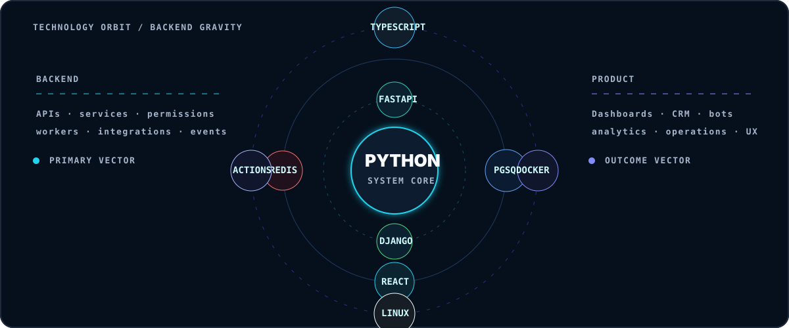

<div align="center">


<a href="https://t.me/cpython99"></a>
<a href="https://www.linkedin.com/in/yauheni-alesich-5937a7262/"></a>
<a href="mailto:quasimodo20042001@gmail.com"></a>

<br/><br/>

[](https://git.io/typing-svg)

</div>

<h2 align="center"><code>// WHO_AM_I</code></h2>

I'm **Evgeny Alesich**, a product-minded backend engineer from Minsk. I build systems where the hard part is not a single endpoint — it is making people, permissions, data, jobs, integrations and interfaces behave like one reliable product.

My strongest zone is the space between **backend architecture and business reality**: CRM platforms, analytics pipelines, learning products, Telegram ecosystems, internal tools and automation that replaces fragile manual work.

```yaml
role: Product Backend Engineer
core: [Python, Django, FastAPI, PostgreSQL, Redis]
interface: [React, TypeScript, Telegram, REST, WebSockets]
delivery: [Docker, Linux, GitHub Actions, pytest]
operating_mode: "own the outcome, not just the ticket"
```

<div align="center">
  
</div>

<h2 align="center"><code>// TECH_ORBIT</code></h2>

<div align="center">
  
</div>

<div align="center">


</div>

<h2 align="center"><code>// SYSTEMS_SHIPPED</code></h2>

<table>
<tr>
<td width="50%" valign="top">

### ♠ Learning ecosystems

Multi-role platforms with onboarding journeys, task engines, progress tracking, content, AI-assisted analysis, CRM operations, Telegram bots and Mini Apps.

`FastAPI` `PostgreSQL` `Redis` `Telegram` `Docker`

</td>
<td width="50%" valign="top">

### ◈ Analytics platforms

Pipelines that collect events, reconcile sources and transform raw activity into attribution, funnels, reports and operational decisions.

`Python` `SQL` `Workers` `React` `Dashboards`

</td>
</tr>
<tr>
<td width="50%" valign="top">

### ⬡ CRM & operations

Role-aware workspaces for leads, tasks, comments, kanban flows, reporting and real-time collaboration — designed around the actual process.

`Django` `DRF` `Channels` `React` `TypeScript`

</td>
<td width="50%" valign="top">

### ⚡ Automation networks

Bots, schedulers, parsers, notifications and synchronization workers that connect teams and services while keeping failures recoverable.

`Webhooks` `External APIs` `Queues` `Monitoring` `Linux`

</td>
</tr>
</table>

<h2 align="center"><code>// ENGINEERING_PROTOCOL</code></h2>

```text
01  MAP THE REAL WORKFLOW     → understand actors, state and failure modes
02  DESIGN CLEAN BOUNDARIES   → keep domain rules independent and testable
03  SHIP VERTICAL SLICES      → deliver visible value early
04  MAKE THE SYSTEM TALK      → logs, metrics, dashboards and alerts
05  AUTOMATE THE BORING       → remove repetition without hiding complexity
```

> **My rule:** architecture is valuable only when it makes the product easier to change, operate and trust.

<h2 align="center"><code>// LIVE_GITHUB_SIGNAL</code></h2>

<div align="center">


<br/>



<br/>


</div>

---

<div align="center">

### `BUILDING SYSTEMS THAT MAKE COMPLICATED WORK FEEL OBVIOUS.`

**Hard products. Clear architecture. Useful automation.**

</div>
