<div align="center">



<br />

[](https://t.me/cpython99)
[](https://www.linkedin.com/in/yauheni-alesich-5937a7262/)
[](mailto:quasimodo20042001@gmail.com)

</div>

## `01 / PROFILE`

I engineer **backend-heavy products** where business workflows, data and automation meet.
My usual territory is a system with many moving parts: APIs, roles and permissions, event-driven jobs,
analytics pipelines, Telegram interfaces, operational dashboards and the infrastructure holding it together.

```python
engineer = {
    "focus":     ["product backends", "data platforms", "automation"],
    "backend":   ["Python", "Django", "FastAPI", "PostgreSQL", "Redis"],
    "frontend":  ["React", "TypeScript", "MUI", "Tailwind"],
    "delivery":  ["Docker", "GitHub Actions", "Linux", "pytest"],
    "principle": "turn complex operations into clear, reliable software",
}
```

<div align="center">
  
</div>

## `02 / ENGINEERING STACK`

<div align="center">


</div>

| Layer | Tools I reach for | What I optimize for |
|:--|:--|:--|
| **Backend** | Python · Django · DRF · FastAPI | clean boundaries, predictable APIs, secure access |
| **Data** | PostgreSQL · Redis · SQLAlchemy | traceable data, fast reads, reliable synchronization |
| **Product UI** | React · TypeScript · MUI · Tailwind | dense workflows that still feel simple |
| **Automation** | Telegram API · webhooks · workers · integrations | fewer manual steps, observable execution |
| **Delivery** | Docker · Linux · pytest · GitHub Actions | repeatable environments and confident releases |

## `03 / SYSTEMS I BUILD`

<table>
<tr>
<td width="50%" valign="top">

### ♠ Learning & operations platforms

Multi-role products with onboarding journeys, task engines, progress tracking, content delivery and AI-assisted analysis. Backend services, CRM tooling, Telegram bot and Mini App work as one system.

`FastAPI` `PostgreSQL` `Redis` `Telegram` `Docker`

</td>
<td width="50%" valign="top">

### ◈ Analytics & attribution

End-to-end pipelines that collect business events, reconcile sources and turn raw activity into funnels, reports and operational dashboards people can actually use.

`Python` `SQL` `React` `Data pipelines` `Dashboards`

</td>
</tr>
<tr>
<td width="50%" valign="top">

### ⬡ CRM & internal tooling

Role-aware workspaces for leads, tasks, comments, kanban flows, reporting and real-time collaboration — shaped around the process instead of a generic admin template.

`Django` `DRF` `Channels` `React` `TypeScript`

</td>
<td width="50%" valign="top">

### ⚡ Workflow automation

Bots, schedulers, parsers, notification services and synchronization workers that connect teams and systems while keeping failures visible and recoverable.

`Workers` `Webhooks` `External APIs` `Monitoring` `Linux`

</td>
</tr>
</table>

## `04 / HOW I ENGINEER`

```text
DISCOVER        MODEL           BUILD           OBSERVE          IMPROVE
business flow → domain rules  → small slices  → real signals  → measured iteration
```

- **Business-first architecture** — understand the workflow before designing endpoints.
- **Boring reliability** — explicit state, idempotent jobs, useful logs and recoverable failures.
- **Product ownership** — backend, UI and delivery are parts of one user outcome.
- **Data visibility** — if a process matters, its state and performance should be visible.
- **Pragmatic design** — enough structure to scale, without architecture for architecture's sake.

## `05 / GITHUB SIGNAL`

<div align="center">


<br />


</div>

---

<div align="center">

### Building systems that make complicated work feel obvious.

`OPEN TO STRONG PRODUCTS · HARD PROBLEMS · USEFUL AUTOMATION`

</div>
