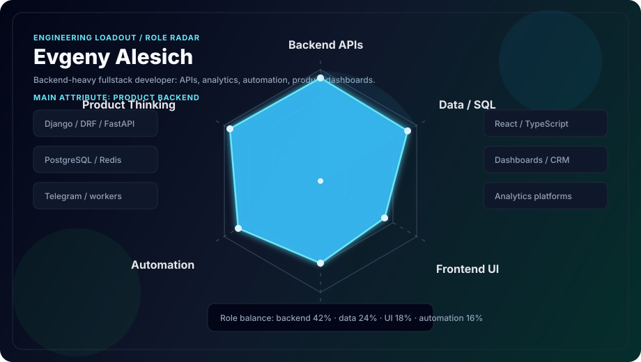
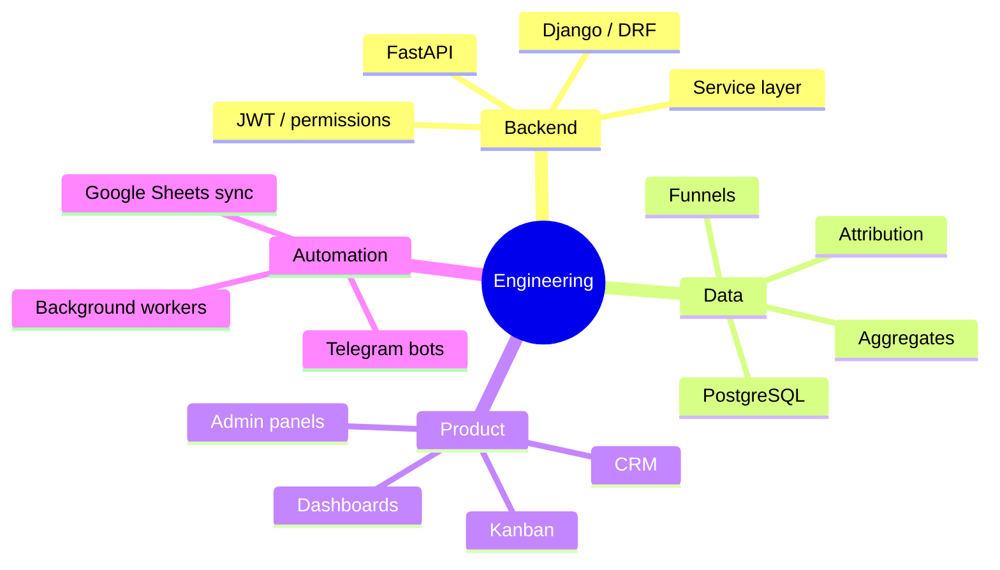
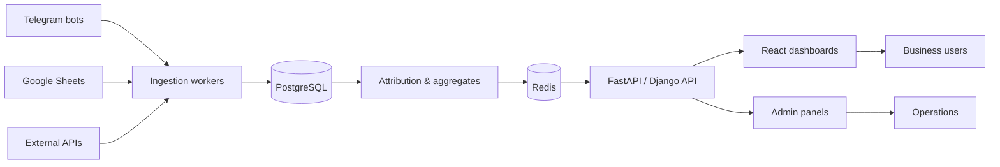

## About

Python developer focused on backend systems, internal platforms, dashboards and automation. I work mostly with Django, FastAPI, PostgreSQL, Redis, Telegram integrations, analytics pipelines and fullstack product interfaces.

I like projects where code is connected to a clear business process: orders, leads, funnels, meetings, CRM panels, reports, sync jobs, bots and admin tools.

`Backend APIs` · `Data pipelines` · `Dashboards` · `Telegram automation` · `CRM / admin panels` · `Product tooling`

## Skill Radar

## Current Focus

| Area | What I build | Stack |
|---|---|---|
| Backend APIs | service layers, auth, admin APIs, background jobs | Python, Django, DRF, FastAPI |
| Data & analytics | funnels, attribution, sync workers, dashboards | PostgreSQL, SQLAlchemy, Redis, RQ |
| Product tools | CRM, kanban, reports, internal panels | React, TypeScript, MUI, Tailwind |
| Automation | Telegram bots, Google Sheets sync, meeting processors | Telegram API, webhooks, workers |
| Delivery | Dockerized local setups, docs, tests | Docker, pytest, GitHub |

## What I Ship

## Highlight Projects

| Project | Why it matters | Tech |
|---|---|---|
| [skvozhnaya-analitika](https://github.com/evgenyalesich/skvozhnaya-analitika) | End-to-end marketing analytics for Telegram bots and PokerHub: funnels, attribution, reporting, sync workers | FastAPI, React, PostgreSQL, Redis |
| [project-manager](https://github.com/evgenyalesich/project-manager) | Fullstack project management system with Kanban, roles, comments and real-time updates | Django, DRF, Channels, React, TypeScript |
| [goldsort-shop-final](https://github.com/evgenyalesich/goldsort-shop-final) | Jewelry e-commerce platform with catalog, cart, orders, payments, CRM dashboard and parser | Django, PostgreSQL, BePaid, Playwright |
| [ai-classify-project](https://github.com/evgenyalesich/ai-classify-project) | Text classification API with React interface and Swagger endpoint | FastAPI, React |
| [pokerhub-platform](https://github.com/evgenyalesich/pokerhub-platform) | PokerHub backend platform evolution | Python |
| [bottg](https://github.com/evgenyalesich/bottg) | Telegram bot experiments and automation base | Python |

## System Map

## Stack

## GitHub Stats

 

 

 

## Engineering Style

| Principle | How I apply it |
|---|---|
| Business-first architecture | I model real workflows before writing endpoints |
| Clean backend boundaries | Service layer, repositories, schemas, permissions |
| Data visibility | Dashboards, reports, funnels and admin screens |
| Practical automation | Workers and integrations that remove repeated manual work |
| Maintainability | Clear setup, focused tests, explicit configuration |

## Contact

